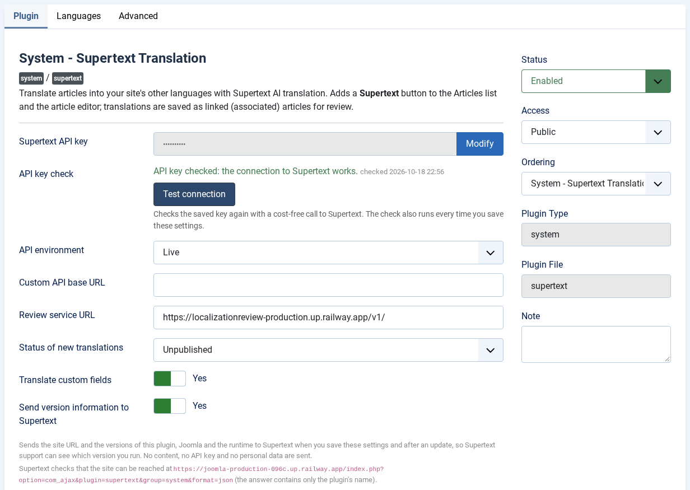
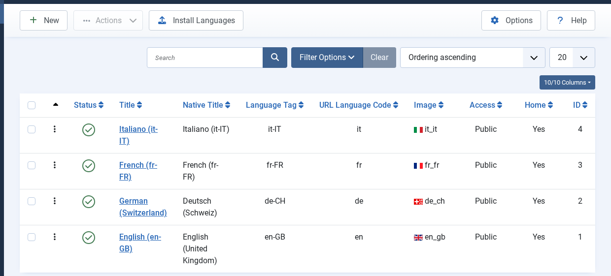
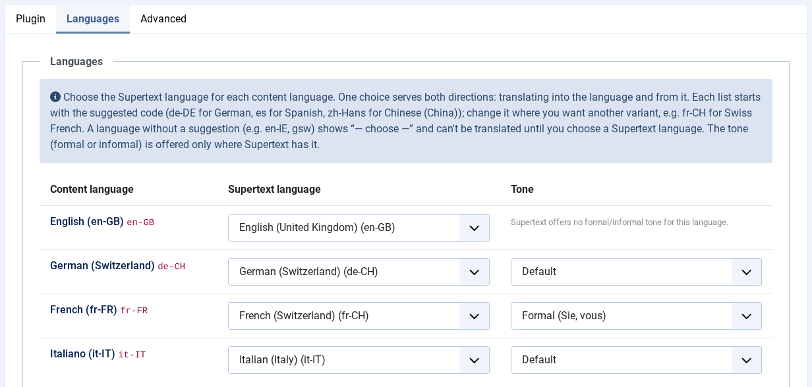

# Installation guide — Supertext Translation for Joomla

For administrators setting up the plugin on a Joomla site.

## Just want to try it?

A ready-to-run container with Joomla 6.1, English sample articles, German (Switzerland), French and Italian, and this plugin is in `demo/`. It is also what runs the public Supertext demo. See the *Demo* section of the [developer guide](DEVELOPER.md#demo-railway).

## Requirements

| | |
| --- | --- |
| Joomla | 6.1 (tested), 5.4 (supported, not yet tested) |
| PHP | Whatever your Joomla version needs (8.3+ for Joomla 6), with `ext-dom` and `ext-curl` (or `allow_url_fopen`) |
| Database | Any database Joomla supports (MySQL, MariaDB, PostgreSQL) |
| Joomla setup | A multilingual site: at least two content languages and *Item Associations* switched on (step 3) |
| Supertext | An account with an API key, see [Get a Supertext account and API key](#get-a-supertext-account-and-api-key) |
| Network | The web server must reach `https://api.supertext.com` over HTTPS |

## 1. Install the plugin

The plugin isn't in the Joomla Extensions Directory yet. Download `plg_system_supertext-<version>.zip` from the [Releases page](https://github.com/Supertext/Joomla-Supertext-Translation/releases), or build the package from this repository:

```bash
./build.sh            # creates dist/plg_system_supertext-<version>.zip
```

Then in Joomla: *System → Install → Extensions → Upload Package File* and drop the zip. Or on the command line:

```bash
php cli/joomla.php extension:install --path=/path/to/plg_system_supertext-0.1.0.zip
```

## 2. Enable it and set the API key

### Get a Supertext account and API key

1. **Account:** no Supertext account yet? [Log in or create one](https://www.supertext.com/person/en/account/signin) with your email address.
2. **API key:** generate it at [supertext.com → Integrations → API](https://www.supertext.com/en/integrations/api). Only users with the **Admin** role in the Supertext account can do this; otherwise ask your Supertext account admin for a key.

The plugin settings link to both pages, next to the API key field.

### Enter it in Joomla

*System → Manage → Plugins*, search for **Supertext**, open **System - Supertext Translation**:

1. Set **Status** to *Enabled*.
2. Click **Modify** next to *Supertext API key*, paste your key and click **Save**. You can paste it exactly as Supertext shows it, with the leading `Supertext-Auth-Key`, or without it.
3. Saving checks the key with Supertext right away (a cost-free call, nothing is translated) and shows the result at the top of the page and under **API key check**: *API key checked: the connection to Supertext works.* means everything is in place. **Test connection** runs the same check again at any time.



The key stays saved when you change other settings later (the field is locked until you click **Modify**; clear it after **Modify** to remove the key).

On servers you can set the key as the environment variable **`SUPERTEXT_API_KEY`** instead. It takes precedence over the field, keeps the key out of the database, and the settings page then says that the environment variable is used. The plugin then checks the key whenever it changes (it compares a fingerprint, never the key itself).

## 3. Set up the languages

The plugin translates into your site's **content languages** and links the translations with Joomla's **associations**, so the site needs to be multilingual:

1. **Install the language packs** you need: *System → Install → Languages*. Joomla creates a content language for each one.
2. **Publish the content languages**: *System → Manage → Content Languages*.

   

3. **Switch on associations**: *System → Manage → Plugins → System - Language Filter*, enable the plugin and set **Item Associations** to *Yes*.

   

4. Give every content language its own **home page** (a menu item set as *Home* for that language) and add a **Language Switcher** module, so visitors can reach the translations. *Home Dashboard → Multilingual Status* shows what's still missing.

Joomla's own guide covers the details: [Setting up a multilingual site](https://docs.joomla.org/J4.x:Setup_a_Multilingual_Site).

Articles must have a language of their own (not *All*) to be translated.

### Supertext languages and tone

Each content language needs a **Supertext language**. Supertext accepts exactly these target codes (from its `features` list, October 2026):

| Language | Supertext codes |
| --- | --- |
| German, English, French, Italian, Portuguese | `de-DE`, `de-CH`, `de-AT`, `en-US`, `en-GB`, `fr-FR`, `fr-CH`, `it-IT`, `it-CH`, `pt-PT`, `pt-BR` |
| Chinese, Serbian | `zh-Hans` (Simplified), `zh-Hant` (Traditional), `sr-Latn`, `sr-Cyrl` |
| Swiss German | `gsw-u-sd-chzh` (Zurich), `gsw-u-sd-chbe` (Bern) |
| All others, without region | `bg`, `cs`, `da`, `el`, `es`, `fi`, `hr`, `hu`, `ja`, `ko`, `nb`, `nl`, `pl`, `rm`, `ru`, `sk`, `sl`, `sq`, `sv`, `tr` |

- A content language whose tag **is** one of these codes (apart from upper/lower case) is sent as it is: `de-CH`, `fr-FR`, `it-IT`, `en-GB`.
- **Every other content language needs a row on the plugin's Languages tab.** Joomla's tags always have a region, so this is the case for most languages outside German, English, French, Italian and Portuguese: `es-ES` → *Spanish — es*, `nl-NL` → *Dutch — nl*, `zh-CN` → *Chinese (Simplified) — zh-Hans*, `nb-NO` → *Norwegian Bokmål — nb*. The plugin never guesses: a language without a Supertext language is reported as *has no Supertext language yet* and nothing is sent for it.
- A row can also send **another code** for a language Supertext has, e.g. `fr-CH` (Swiss French) for the `fr-FR` content language, and choose the **tone**: *Formal (Sie, vous)*, *Informal (du, tu)* or the Supertext default. Supertext offers no formal/informal choice for English, Swiss German, Romansh, Albanian and Serbian: leave those on *Default* (otherwise their translations fail with *Supertext offers no formal or informal tone for this language*).
- The source language is sent without region: the article's language (or the code of its row) reduced to the language, `en-GB` → `en`, `de-CH` → `de`.

On the **Languages** tab, *Your content languages* shows every content language with the Supertext language it is sent as, **Not mapped** for those that still need a row, and a warning for a tone Supertext doesn't offer. Choosing a content language in a new row pre-selects its Supertext language if its tag is one; the *Supertext language* list shows every code above with its name.



## 4. Check it works

Open *Content → Articles*, tick an article and click **Supertext** (see the [user guide](USER_GUIDE.md)). Or from the command line:

```bash
php cli/joomla.php supertext:translate <article-id> --to=de-CH
```

## Version information and the API key check

**Send version information to Supertext** (on the *Plugin* tab) is on by default. The plugin then sends the site URL and the versions of this plugin, Joomla and PHP to Supertext when you save the plugin settings and after an update (of the plugin, Joomla or PHP), so Supertext support can see which version you run. A report contains exactly:

- the site URL (Joomla's base URL, `live_site` if set),
- the plugin's name (`Joomla-Supertext-Translation`) and version, the Joomla and PHP versions and the version of the bundled Supertext SDK,
- whether an API key is set, and the result of the API key check below (status, time, HTTP status, Supertext's error code),
- the address of the ping endpoint below.

**No content, no API key and no personal data are sent.** Reports go from your web server, never from the editor's browser, wait at most 3 seconds, run after the page has been answered where PHP allows it (PHP-FPM) and never slow down or break a save or a translation; a report that fails is not tried again for an hour. Switch the setting off to send nothing at all; the ping endpoint then answers 404. On servers, the environment variable **`SUPERTEXT_VERSION_REPORTS=0`** turns it off whatever the setting says (`1` turns it on); the settings page says so when it is set.

**The API key check** runs whether or not version information is sent: every time you save the plugin settings, on **Test connection**, when a back-end page of the plugin finds a key it hasn't checked yet (e.g. a new `SUPERTEXT_API_KEY`), and when Supertext rejects the key during a translation. It is Supertext's cost-free `features` call; nothing is translated or billed. The settings page shows the latest result with its time: *the connection to Supertext works*, *Supertext rejected the API key* or *No API key is set yet* (both with the links to create an account and generate a key), *Supertext can't be reached*, or *Supertext answered with an error*.

**The ping endpoint** `<site URL>/index.php?option=com_ajax&plugin=supertext&group=system&format=json&challenge=…` is public (no login) and answers only `{"ok":true,"plugin":"Joomla-Supertext-Translation","challenge":"…"}`, so Supertext can see that the site is reachable from the internet. It returns nothing else (no versions, no settings, no data), is never cached by Joomla's page cache and is answered before the Language Filter could redirect it. The settings page shows its address.

The plugin keeps what it reported last and the latest key check in its own row of `#__extensions` (column `custom_data`): status, time, HTTP status, Supertext's error code and a SHA-256 fingerprint of the key, never the key itself. Updating the plugin keeps it; uninstalling removes it.

## Who can translate

Anyone who can **edit** the source article can open the Supertext dialog. Creating a translation also needs **Create** permission in the category the translation goes into; updating an existing translation needs **Edit** (or *Edit Own*) on it. These are Joomla's normal article permissions (*Content → Articles → Options → Permissions*, or per category).

## Interface languages

The plugin's dialog, settings and messages are available in English, German (`de-DE` and `de-CH`), French (`fr-FR`) and Italian (`it-IT`). They follow each user's backend language: install the Joomla language pack (*System → Install → Languages*), then choose the language under *Users → Manage → (user) → Basic Settings → Backend Language*, or set the default under *System → Languages* (Administrator). Other backend languages show the English texts.

## All settings

| Setting | Default | Purpose |
| --- | --- | --- |
| Supertext API key | – | Your key, with or without the `Supertext-Auth-Key` prefix. The `SUPERTEXT_API_KEY` environment variable wins. |
| API environment | Live | `Live`, `Staging` or `Testing` Supertext API |
| Custom API base URL | – | Overrides the environment (e.g. a test server). The `SUPERTEXT_API_ENDPOINT` environment variable wins. |
| Status of new translations | Unpublished | Unpublished lets an editor review translations first; or Published |
| Translate custom fields | Yes | Translate Text, Textarea and Editor custom fields; other custom fields are copied unchanged |
| Send version information to Supertext | Yes | Site URL and versions to Supertext after saving and after updates (see [Version information and the API key check](#version-information-and-the-api-key-check)). The `SUPERTEXT_VERSION_REPORTS` environment variable (`0`/`1`) wins. |
| Languages (tab) | – | Per content language: its Supertext language (needed for every content language whose tag isn't a Supertext code, see [Supertext languages and tone](#supertext-languages-and-tone)) and tone |
| Timeout (Advanced) | 180 s | Maximum wait for one translation |
| Status check interval (Advanced) | 2 s | Time between status checks |

## Updating

Install the new package over the old one (*System → Install → Extensions*, or `extension:install`). Settings are kept. The next back-end page of the plugin reports the update to Supertext (if *Send version information* is on).

**Updating from 0.1.0:** languages are no longer guessed. Content languages whose tag is a Supertext code (`de-CH`, `fr-FR`, `it-IT`, `en-GB`, …) work as before; for every other content language (e.g. `es-ES`, `nl-NL`, `zh-CN`) add a row on the *Languages* tab (see [Supertext languages and tone](#supertext-languages-and-tone)). *Your content languages* shows which ones are *Not mapped*. A *Supertext language code* you entered before stays selected; if it isn't a Supertext code (e.g. `es-ES`), it is marked *(not a Supertext code)*: choose the right one (`es`).

## Uninstalling

*System → Manage → Extensions*, select **System - Supertext Translation**, **Uninstall**. Translations created so far stay, as normal articles.

## Troubleshooting

| Message | Cause / fix |
| --- | --- |
| *Supertext is not set up yet* | No API key: enter it in the plugin settings (step 2), or set `SUPERTEXT_API_KEY`. |
| *Authentication failed* | The key is wrong or revoked. Check it with **Test connection**; if needed, generate a new one at [supertext.com → Integrations → API](https://www.supertext.com/en/integrations/api) (Admin role required). |
| *Supertext rejected the API key* (API key check) | Check that the whole key was copied, or generate a new one at [supertext.com → Integrations → API](https://www.supertext.com/en/integrations/api) (Admin role required). No Supertext account yet? [Create one](https://www.supertext.com/person/en/account/signin). Save, or click **Test connection**. |
| *The API key couldn't be checked because Supertext can't be reached* | The web server can't reach `api.supertext.com` (firewall, proxy, DNS). Translations need the same connection. |
| *The language … has no Supertext language yet* / *Not mapped* on the Languages tab | The content language's tag isn't a Supertext code: add a row for it on the plugin's *Languages* tab and choose its Supertext language (see [Supertext languages and tone](#supertext-languages-and-tone)). |
| *Supertext offers no formal or informal tone for this language* | The row's tone is *Formal* or *Informal* for a language without that choice (English, Swiss German, Romansh, Albanian, Serbian): set it to *Default*. |
| *Multilingual associations are switched off* | Set *Item Associations* to *Yes* in the *System - Language Filter* plugin (step 3). |
| *This article's language is "All"* | Give the article a specific language first. |
| *… is not a content language of this site* | The language was removed or unpublished; check *Content Languages*. |
| *You are not allowed to create articles in the category used for …* | The user lacks *Create* permission there (see *Who can translate*). |
| *Supertext does not support this language pair (en → xx-YY)* | The code sent isn't one Supertext offers for this source (e.g. a code marked *not a Supertext code* on the Languages tab, or the same language as the source). Choose a Supertext language from the list; the message shows the codes that were sent. |
| *Too many requests to Supertext* | Supertext's per-second limit was still exceeded after 4 automatic retries. Wait a moment and translate again. |
| *Your Supertext translation limit is exceeded* | Your Supertext plan's volume is used up. |
| *Timed out waiting* | Very long articles: raise the *Timeout* (and PHP's `max_execution_time`). |
| *Could not reach Supertext* | The server can't make outbound HTTPS calls; check the firewall or proxy (*Global Configuration → Server → Proxy*). |
| No **Supertext** button | The plugin is disabled, you're on a new, unsaved article, or the user can't manage articles. |

## Security notes

- Prefer the `SUPERTEXT_API_KEY` environment variable on servers: the key then never sits in the database or its backups.
- Version reports and the ping endpoint never contain the key or any content (see [Version information and the API key check](#version-information-and-the-api-key-check)); switch them off with the setting or `SUPERTEXT_VERSION_REPORTS=0`.
- The plugin only talks to the Supertext API you configured. Documents are deleted from Supertext right after download (and expire after 24 hours anyway).
