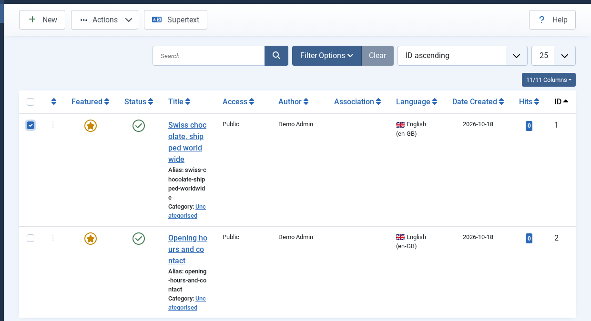
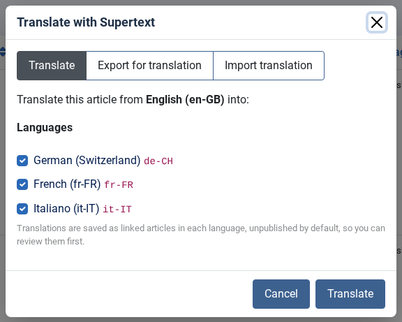
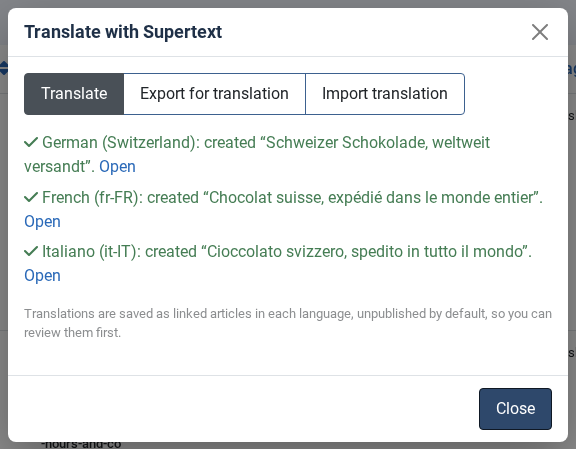
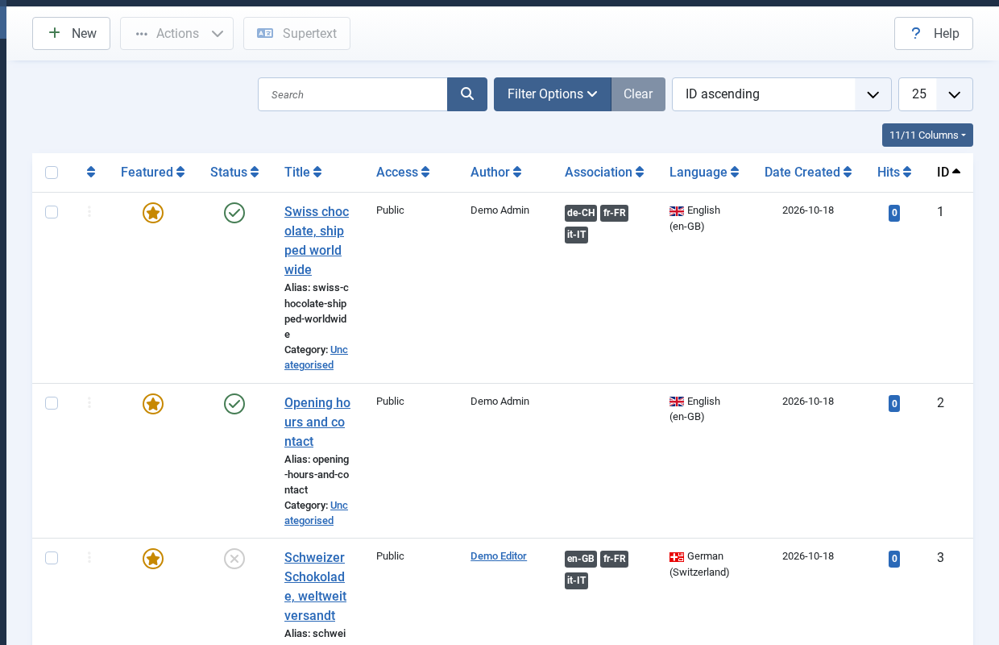
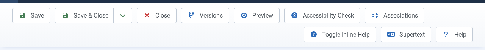
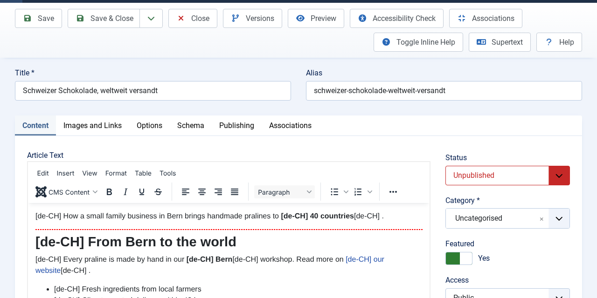
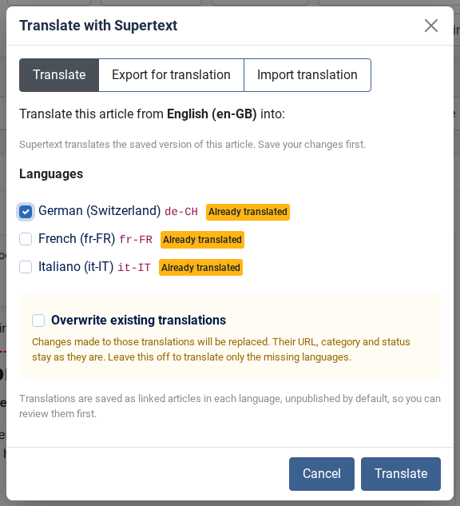
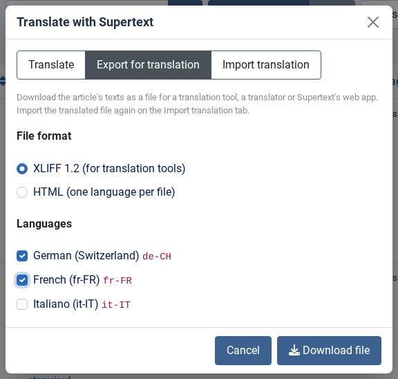
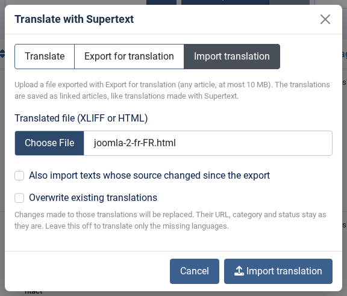
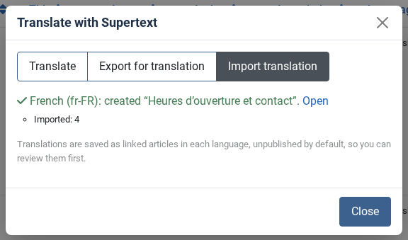

# User guide — Supertext Translation for Joomla

For editors. Once an administrator has set up the plugin (see [INSTALLATION.md](INSTALLATION.md)), you translate articles from the Joomla backend with one click. Supertext writes the translation; you review and publish it.

The Supertext dialog and its messages appear in your Joomla backend language (English, German, French or Italian).

## Try it on the demo

The Supertext Joomla demo (ask Supertext for the address and a backend login) has two English sample articles and German (Switzerland), French and Italian set up as languages. Translate an article as described below, then open it in the other language on the site.

## Translate articles from the list

*Screenshots: Joomla 6.1 with the demo content.*

1. Open **Content → Articles** and tick the article(s) you want to translate.
2. Click **Supertext** in the toolbar.

   

3. Tick the languages to translate into. Languages that don't have a translation yet are ticked for you.

   

4. Click **Translate**. It usually takes a few seconds per language. The dialog then lists each translation with an **Open** link.

   

Each translation is a new article in that language, linked to the original (you see the language badges in the **Association** column). It is **unpublished** (unless your administrator chose otherwise), keeps the original's category, featured setting, access and options, and gets a URL alias from the translated title.

## Translate from the article editor

While editing an article, the **Supertext** button is in the editor's toolbar too. It translates the **saved** version of the article, so save your changes first.

The new translations are added to the article's *Associations* tab straight away, so saving the article afterwards keeps them linked. If the same article is open in another browser tab, reload that tab before saving there.

## Review and publish

1. Click **Open** in the dialog (or open the translation from the Articles list).
2. Read the translation and adjust anything you'd phrase differently.
3. Set **Status** to *Published* and save.

## Translating again

If an article already has a translation in a language, the dialog marks it **Already translated** and leaves it unticked. Tick it and Supertext asks whether to **Overwrite existing translations**:

- **Off** (default): only the languages without a translation are translated; existing ones are skipped.
- **On**: the existing translation is replaced with a fresh translation of the current original. Edits made to the translation are lost. Its URL alias, category, status and other settings stay as they are.

**Translation review:** if your administrator turned on *Translation review* for a language, reviewers (your colleagues or Supertext linguists) check and correct the translations on the website. Their corrections come into Joomla the next time you translate the article into that language: after a review, translate it again with **Overwrite existing translations** on. Texts reviewed once keep their corrected wording in later translations.

## Export for translation and import the translated file

Instead of translating with Supertext straight away, you can download an article's texts as a file, have it translated elsewhere (a translation tool such as Trados, memoQ or Phrase, a translator, or Supertext's web app) and import the translated file again. The file holds exactly the texts the **Translate** button would send.

**Export:**

1. Select **one** article in the Articles list (or open it in the editor) and click **Supertext**.
2. Click **Export for translation**.
3. Choose the **File format**:
   - **XLIFF 1.2 (for translation tools)**: the better choice for translation tools and translators. Formatting (bold, links, lists) is shown as protected tags, so it can be moved but not broken. One file can hold several languages.
   - **HTML (one language per file)**: for Supertext's web app or anyone who translates HTML files. Choose exactly one language.
4. Tick the languages and click **Download file**. The file is called e.g. `joomla-2-fr-FR.xlf` (`joomla-2.xlf` with several languages; `.html` for HTML).

Send the file to your translator, or upload it to Supertext's web app. Whoever translates an **HTML** file must leave its `<head>` and the `data-st-id` attributes alone: the plugin needs them to find the article and the texts again. An HTML file can't mark a text as untranslated, so an HTML file imported unchanged writes the original (source) text into the translation.

**Import:**

1. Click **Supertext** on any article (the file itself says which article and language it belongs to) and click **Import translation**.
2. Choose the **Translated file (XLIFF or HTML)** (at most 10 MB).
3. Tick **Also import texts whose source changed since the export** only if you want texts that were edited in the original after the export to be imported anyway (their translation may no longer match). Off by default.
4. Tick **Overwrite existing translations** if the article already has a translation in that language and you want to replace it. Off, the existing translation is left alone and the language is reported as *already translated, skipped*.
5. Click **Import translation**.

The translation is saved like one made with **Translate**: as a linked article in that language, unpublished by default, so you can review it. A translation that already exists keeps the texts the file doesn't have. The summary shows, per language:

| Line | Meaning |
| --- | --- |
| *Imported: N* | Texts written into the translation. |
| *Skipped, source changed since the export: N* | The original text was edited after the export. Import again with *Also import texts whose source changed since the export*, or export again. |
| *Not translated in the file: N* | The file has no translation for these texts (e.g. empty in the translation tool). |
| *Formatting changed, not imported: N* | The translation broke or added formatting (tags) that the original doesn't have. Fix it in the file and import again. |
| *Not in the file: N* | Texts added to the article since the export. Export again to translate them. |

| Message | What it means |
| --- | --- |
| *This file isn't a valid XLIFF or HTML translation file.* | Not an XLIFF or HTML file, or damaged. |
| *This file wasn't exported by the Supertext plugin, or its header was removed.* | The file has no Supertext information (e.g. an HTML file whose `<head>` was removed). |
| *The file is too large (at most 10 MB).* | Split the work into smaller files. |
| *This file belongs to another system (…).* | The file was exported by a Supertext plugin for another CMS. |
| *The article this file was exported from no longer exists.* | The original article was deleted. |
| *The site has no content language ….* | The language was removed from the site (or is the article's own language). |
| *Nothing to translate.* (export) | The article has no text to translate. |

## What gets translated

- Title
- Article text (intro and full text), with headings, bold and italic text, links, lists and tables kept
- Meta description and meta keywords
- Alt texts and captions of the intro and full-text images
- The labels of the article's links A, B and C
- Custom fields of the types Text, Textarea and Editor (if your administrator left that on)

## What is *not* translated

- Joomla plugin tags such as `{loadmodule mod_custom}` or `{loadposition sidebar}`: they are copied unchanged
- Images, link URLs, dates, numbers, tags and other custom field types: copied unchanged
- Categories, menus and modules (translate those by hand for now)
- Translations that already exist, unless you choose to overwrite them

## Formal and informal language

Your administrator can set each language to formal (*Sie/vous*) or informal (*du/tu*). Ask them if the tone doesn't fit your site. Supertext offers this choice for most languages, but not for English, Swiss German, Romansh, Albanian and Serbian.

## When something goes wrong

Problems are listed in red in the dialog, per article and language; the other languages still get translated.

| Message | What to do |
| --- | --- |
| *Supertext is not set up yet* | Ask your administrator to enter the API key. |
| *This article's language is "All"* | Set the article's language (e.g. English) in the editor, save, and try again. |
| *You are not allowed to …* | You need permission to create or edit articles in that category; ask your administrator. |
| *The language … has no Supertext language yet* | Your administrator hasn't told the plugin which Supertext language to use for it yet. Ask them to choose one for it on the plugin's *Languages* tab (*System → Plugins → System - Supertext Translation → Languages*); the other languages are translated. |
| *Supertext does not support this language pair (en → …)* | Supertext can't translate into this language, or the Supertext language chosen for it on the plugin's *Languages* tab is wrong. Tell your administrator. |
| *Supertext offers no formal or informal tone for this language* | The tone set for that language isn't available at Supertext; ask your administrator to set it to *Default*. |
| *Too many requests to Supertext* | Wait a moment and try again. |
| *Your Supertext translation limit is exceeded* | Your organisation's Supertext volume is used up; contact your administrator. |
| *Timed out waiting …* | Very long article: try again, or ask your administrator to raise the timeout. |

## Tips

- Select several articles in the list to translate them in one go.
- Translations are machine translations of high quality, but always have a quick look before publishing: product names, prices and dates deserve a second glance.
